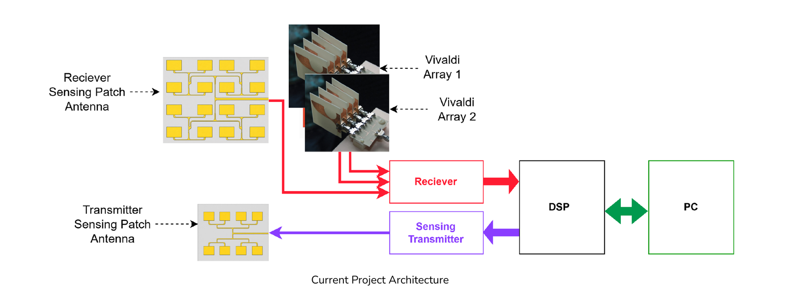
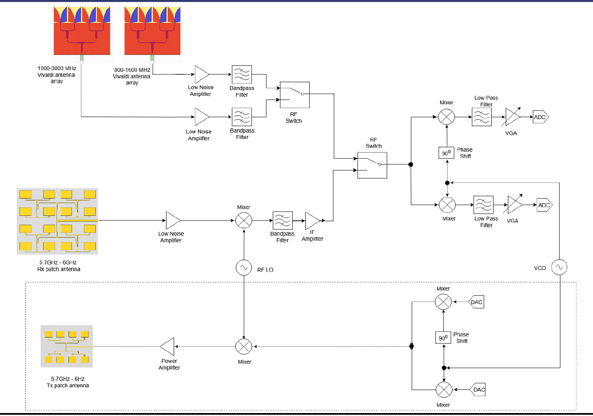
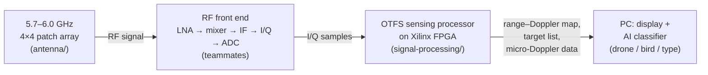

# A Multi-RF Head Receiver Array for AI-Native Sensing and Communications

**Final Year Project – Group 20**
Department of Electronic and Telecommunication Engineering, University of Moratuwa, Sri Lanka

| | |
|---|---|
| **Supervisors** | Dr. Chamira U. S. Edussooriya (University of Moratuwa) · Prof. Arjuna Madanayake (Florida International University, USA) |
| **Sponsor** | Deep Silicon Technologies (Pvt) Ltd – support for components and PCB fabrication |
| **Team** | Ranaweera R.P.D.D.H. (220511N) · Weragoda W.A.A.P. (220692R) · Anuradha D.M.B.P. (220036L) · Peiris P.I.U. (220452H) |
| **Repository owner** | Dulina Ranaweera ([@Dulina14](https://github.com/Dulina14)) |

> This repository holds the full project description and **the two parts of the project that I (Dulina) am responsible for**:
>
> 1. [**Antenna chain**](antenna/) – the 5.7–6.0 GHz, 16-element (4 × 4) microstrip patch array used for drone sensing.
> 2. [**Signal processing chain**](signal-processing/) – the OTFS-based drone-detection signal processing, to be built on a Xilinx FPGA.
>
> Work done by other team members (Vivaldi arrays, RF receiver chain, receiver PCB, communication algorithms) is described here for context only.

---

## 1. What is this project about?

Today, a phone network, a radar, a spectrum monitor and a drone detector are usually **separate boxes**, each with its own antennas and electronics. Future 6G networks aim to do these jobs **together**, using one shared radio. This idea is called **ISAC – Integrated Sensing and Communication**: the same hardware, the same waveform and the same processing chain are used both to *send/receive data* and to *sense the surroundings* (for example, to find a drone and measure how far away it is and how fast it moves).

Our project builds such a shared platform: **one receiver with several "RF heads"**. An *RF head* is one antenna array plus its own front-end electronics, tuned to one frequency band. Each head looks at a different part of the spectrum, and all of them feed one common receiver and one digital processor.

The main application is **counter-drone surveillance**. A drone's spinning propellers add a small, fast-changing frequency shift to the radar echo (called *micro-Doppler*). With AI, this "fingerprint" can be used to tell a drone from a bird, and even one drone type from another.

## 2. What will we build in the end?

| Deliverable | Description |
|---|---|
| **Multi-RF head receiver** | A 4-channel, multi-band RF receiver on a PCB, covering **800 MHz – 8 GHz**, with antenna arrays, RF front ends, tunable filters and programmable gain. |
| **Software application** | Software to configure and control the receiver over USB / Ethernet, process the received data with AI, and show live spectrum, radar and system-status views. |
| **Research paper** | A conference or journal paper on the system architecture, design method and measured results. |
| **Academic artifacts** | Final report, presentation, demonstration video and supporting documents. |

### Target receiver specification (from the project brief)

| Parameter | Target |
|---|---|
| Frequency range | 800 MHz – 8 GHz |
| Noise figure | better than 2 dB |
| Total gain | about 90 dB |
| Instantaneous bandwidth | 400 MHz |
| LNA gain per antenna element | about 40 dB |
| Local oscillator (LO) | low-phase-noise, from an external tunable source |
| Control | embedded processor, via USB / Ethernet |

### The RF heads (antenna arrays)

| RF head | Band | Antenna type | Main use | Owner |
|---|---|---|---|---|
| Vivaldi array 1 | 800 – 1600 MHz | Antipodal Vivaldi | GSM / L-band communication, location intelligence | teammates |
| Vivaldi array 2 | 1000 – 3000 MHz | Antipodal Vivaldi | Cellular, Wi-Fi, Bluetooth communication | teammates |
| Wideband head *(in the proposal)* | 2000 – 8000 MHz | Vivaldi | Spectrum sensing | teammates |
| **Patch array** | **5.7 – 6.0 GHz** (centre 5.85 GHz) | **4 × 4 microstrip patch** | **Drone sensing (Doppler and micro-Doppler)** | **Dulina – [antenna/](antenna/)** |

## 3. System architecture



*Overall architecture. The receive patch array (top left) and the two Vivaldi arrays feed the common receiver. A separate transmit patch array sends the sensing signal. The DSP block (FPGA) processes the received samples and sends results to a PC. Source: Group 20 feasibility study.*



*Planned RF chain. The 5.7–6 GHz patch array has its own LNA, mixer and IF stage; RF switches select the active head; a common I/Q down-converter, low-pass filters, variable-gain amplifiers (VGA) and ADCs deliver baseband samples to the FPGA. The dashed box is the transmit path for the sensing signal. Source: Group 20 feasibility study.*

### How the two parts in this repository connect



1. The **patch array** catches the 5.7–6.0 GHz echo reflected from a drone and turns it into an electrical signal.
2. The **RF front end** amplifies it, shifts it down in frequency and turns it into numbers (I/Q samples).
3. The **OTFS processor** on the FPGA turns those numbers into a *range–Doppler map* (how far away / how fast), finds targets, and collects micro-Doppler data.
4. The **PC** shows the results and runs the AI classifier.

## 4. Repository contents

```
.
├── README.md                     ← you are here (project overview)
├── antenna/                      ← PART 1: 5.7–6.0 GHz 4×4 patch array (Dulina)
│   ├── README.md                 ← design, results, status, how to reproduce
│   ├── hfss-scripts/             ← Python scripts that build the HFSS model + Gerbers
│   │   └── design-history/       ← earlier script versions, in design order
│   ├── hfss-projects/            ← Ansys HFSS project files (.aedt)
│   ├── reports/                  ← geometry / validation reports, geometry JSON
│   ├── fabrication/              ← JLCPCB Gerber + drill files, layout SVG
│   ├── images/                   ← HFSS screenshots, plots, layout previews
│   └── notes/                    ← antenna theory study notes
├── signal-processing/            ← PART 2: OTFS drone-sensing DSP on FPGA (Dulina)
│   ├── README.md                 ← processing chain, parameters, plan, status
│   ├── docs/                     ← detailed FPGA work plan and learning plan
│   ├── python/ofdm-basics/       ← first OFDM exercises (base for OTFS)
│   ├── images/
│   └── references.md             ← papers and reference code
└── docs/
    ├── group-documents/          ← proposal, feasibility study, monthly report, abstract
    └── images/                   ← architecture figures
```

## 5. Project status (October 2026)

| Area | Status |
|---|---|
| Proposal and feasibility study | ✅ Done (July – August 2026) |
| System parameters (SNR, bandwidth, range, link budget) | 🔄 In progress (team) |
| **Patch array – design and simulation** | ✅ Stub-matched 4×4 array simulated in HFSS: S11 = −34 dB at 5.88 GHz, −10 dB band 5.71–6.02 GHz |
| **Patch array – fabrication files** | ⚠️ Gerbers generated for JLCPCB, but the patch length must be corrected before ordering – see [antenna/README.md › Known issue](antenna/README.md#7-known-issue-fix-before-ordering-the-pcb) |
| **Patch array – measurement** | ⏳ After fabrication (VNA S11, radiation pattern) |
| **OTFS signal processing** | 🔄 Phase 0 (learning OFDM → OTFS → radar) and work plan done; golden model next |
| Vivaldi arrays, RF chain, receiver PCB | 🔄 In progress (teammates) |

## 6. Group documents

All in [`docs/group-documents/`](docs/group-documents/):

| Document | Date |
|---|---|
| [Project proposal](docs/group-documents/Group20_Project_Proposal.pdf) | July 2026 |
| [Feasibility study (report)](docs/group-documents/Feasibility_Study.pdf) | August 2026 |
| [Feasibility presentation (slides)](docs/group-documents/Feasibility_Presentation.pdf) | August 2026 |
| [Monthly progress report – September 2026](docs/group-documents/Monthly_Report_September_2026.pdf) | September 2026 |
| [One-page abstract](docs/group-documents/One_Page_Abstract.docx) | September 2026 |

## 7. Key references

- K. Wu *et al.*, "Integrated Sensing and Communication (ISAC) Transceiver: Hardware Architectures, Enabling Technologies, and Emerging Trends," *IEEE JSTEAP*, 2025. doi:10.1109/JSTEAP.2025.3610564
- C. A. Balanis, *Antenna Theory: Analysis and Design*, 3rd ed., Wiley.
- B. Razavi, *RF Microelectronics*, 2nd ed., Prentice Hall, 2012.
- P. Raviteja, K. T. Phan, Y. Hong, E. Viterbo, "Orthogonal Time Frequency Space (OTFS) Modulation Based Radar System," IEEE RadarConf 2019. [arXiv:1901.09300](https://arxiv.org/abs/1901.09300)
- Y. Hong, T. Thaj, E. Viterbo, *Delay-Doppler Communications: Principles and Applications*, Academic Press, 2022.

More references: [antenna/README.md](antenna/README.md#9-references) and [signal-processing/references.md](signal-processing/references.md).

---

*Documents in this repository were written by Group 20 for academic evaluation at the University of Moratuwa. Please ask the authors before reusing them.*
