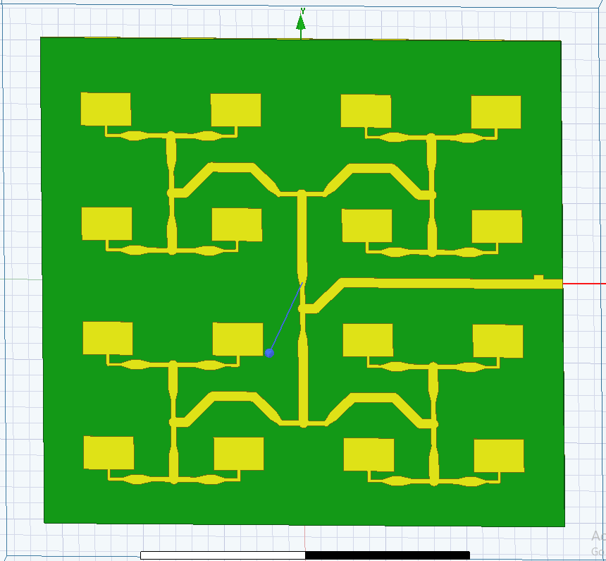
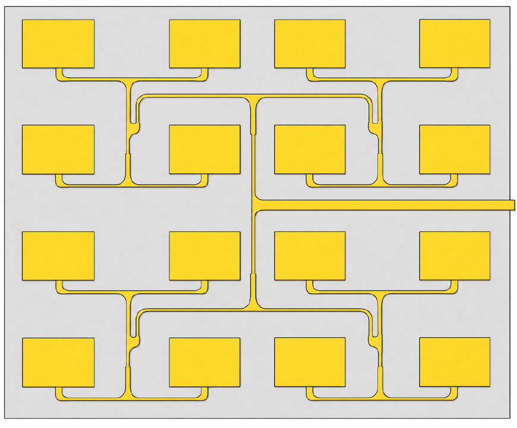
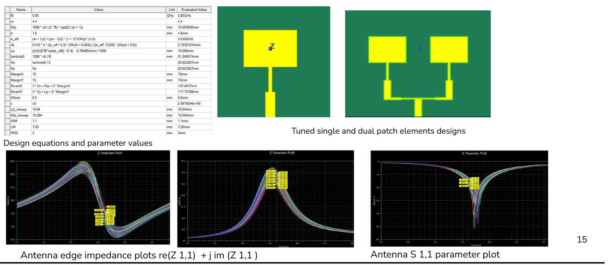
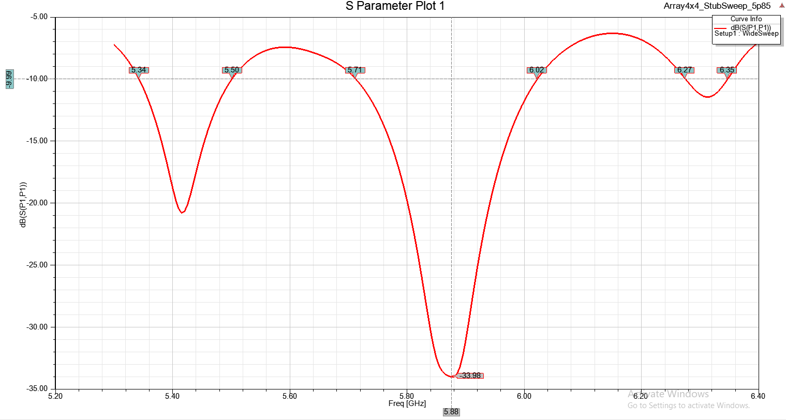
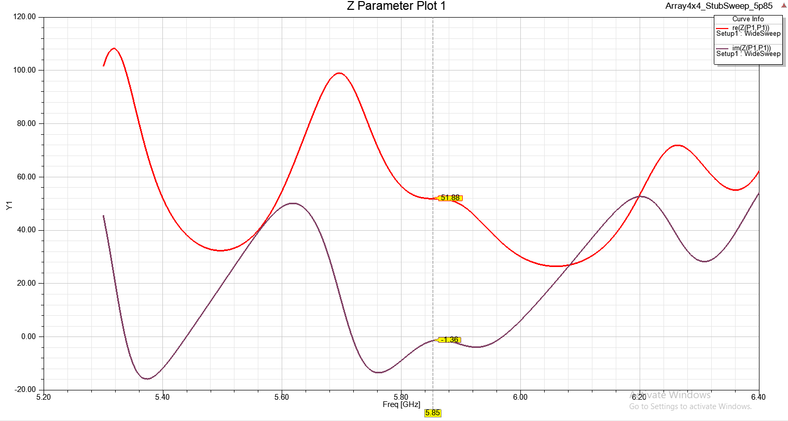
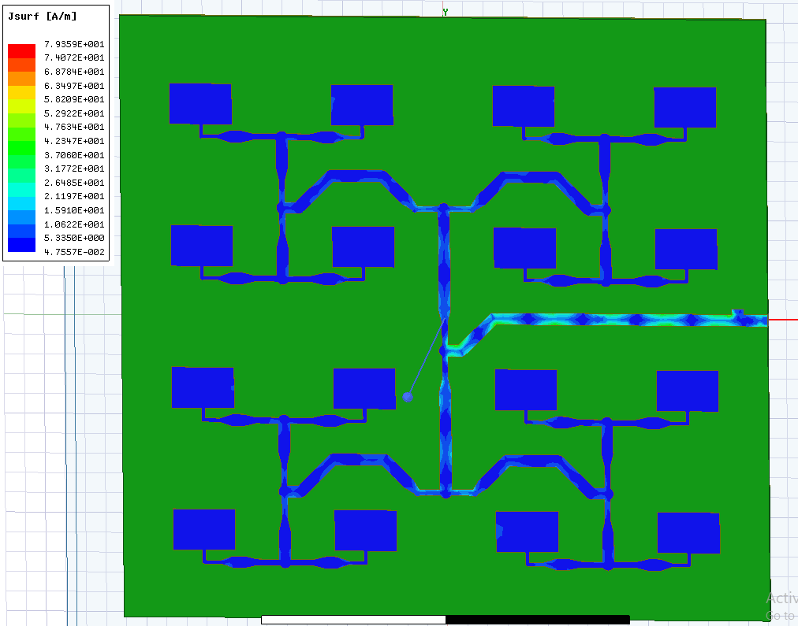
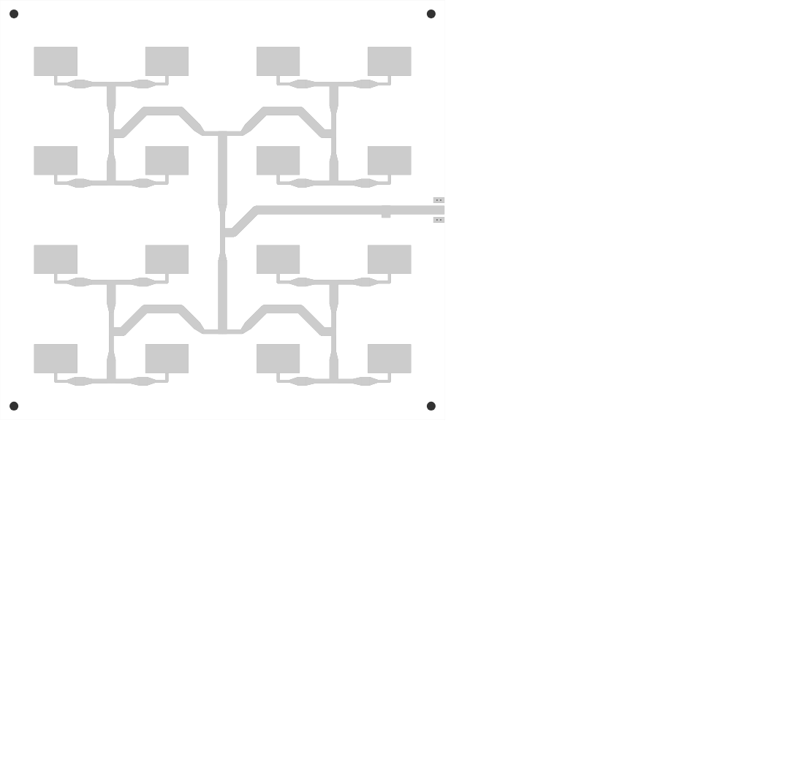
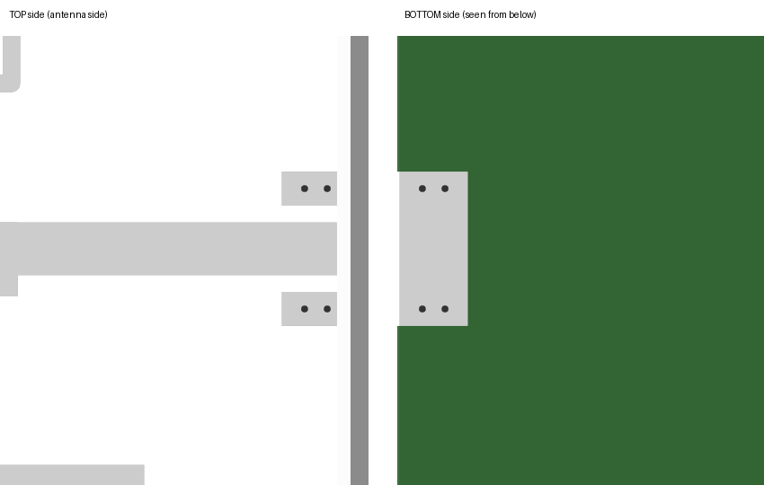

# Part 1 – Antenna Chain: 5.7–6.0 GHz 4 × 4 Microstrip Patch Array

**Owner:** Dulina Ranaweera (220511N) · Group 20 FYP · [← back to project overview](../README.md)

This folder contains the design of the **drone-sensing antenna** of the multi-RF head receiver: a 16-element (4 × 4) microstrip patch array for the **5.7–6.0 GHz** band, centred at **5.85 GHz**, printed on a normal 1.6 mm FR-4 PCB.



*The 4 × 4 array in Ansys HFSS: 16 yellow copper patches, the corporate feed network that joins them, and the 50 Ω input line on the right (where the SMA connector goes). Board size 161 mm × 152 mm.*

---

## Contents

1. [Words used in this section](#1-words-used-in-this-section)
2. [Requirements](#2-requirements)
3. [Why a 4 × 4 patch array?](#3-why-a-4--4-patch-array)
4. [Design – step by step](#4-design--step-by-step)
5. [Simulation results](#5-simulation-results)
6. [Fabrication files (JLCPCB)](#6-fabrication-files-jlcpcb)
7. [Known issue: fix before ordering the PCB](#7-known-issue-fix-before-ordering-the-pcb)
8. [Files in this folder and how to reproduce](#8-files-in-this-folder-and-how-to-reproduce)
9. [Next steps](#9-next-steps) · [References](#10-references)

---

## 1. Words used in this section

| Word | Meaning |
|---|---|
| **Microstrip patch** | A flat rectangle of copper on top of a PCB, with a full copper ground plane on the bottom. At its resonant frequency it radiates (or receives) radio waves upward. |
| **Microstrip line** | A copper track on top of the PCB over the ground plane. It carries the RF signal. Its **width** sets its **impedance** (Z₀, in ohms). |
| **λ₀ / λg** | λ₀ = wavelength in free space (51.25 mm at 5.85 GHz). λg = wavelength *inside* a microstrip line, shorter than λ₀ because the wave travels partly in the FR-4. |
| **Quarter-wave transformer** | A line section λg/4 long with impedance Z_T. It changes a load R into Z_T² / R. Used to match impedances. |
| **Corporate feed** | A "tree" of lines that splits the input signal 1 → 2 → 4 → 8 → 16, so every patch gets the same power and the same phase. |
| **S11 (return loss)** | How much of the signal sent into the antenna bounces back, in dB. **S11 below −10 dB** means less than 10 % of the power is reflected – the usual "good match" rule. |
| **−10 dB bandwidth** | The frequency range over which S11 stays below −10 dB. |
| **Z11** | The input impedance of the antenna, R + jX. Ideal: 50 + j0 Ω. |
| **Open stub** | A short piece of line connected at one end and left open at the other. Used to cancel the reactive (jX) part of the impedance. |
| **Grating lobe** | An unwanted extra main beam that appears if the elements are spaced one wavelength or more apart. |
| **Gerber files** | The standard files a PCB factory (here JLCPCB) uses to make a board: one file per copper / mask / silkscreen layer, plus drill files. |

## 2. Requirements

| Item | Value |
|---|---|
| Band | 5.70 – 6.00 GHz (300 MHz) |
| Centre frequency f₀ | 5.85 GHz |
| Match | S11 < −10 dB over the whole band |
| Input | single 50 Ω port, edge-mount SMA connector |
| Substrate | FR-4, 1.6 mm thick, εr ≈ 4.4 (HFSS uses 4.5 = JLCPCB's value), tan δ = 0.02, 35 µm copper |
| Use in the system | Receive array of the drone-sensing head; a smaller 4 × 2 array of the same design is planned for transmit |

## 3. Why a 4 × 4 patch array?

- **Patch antennas** are flat, cheap and printed directly on a PCB – easy to integrate with the receiver board. Their natural bandwidth is narrow, which suits the narrow 5.7–6.0 GHz drone-sensing band.
- **An array** of N elements gives roughly N times the directivity of one element (D_array ≈ N · D_element). Higher gain means weaker drone echoes can still be detected.
- **A square 4 × 4 layout** gives a narrow beam in both planes (balanced E- and H-plane beamwidths) and allows two-axis beam control later.



*Proposed array concept from the feasibility study (August 2026).*

## 4. Design – step by step

### 4.1 Single patch (hand calculation, then HFSS tuning)

The patch size comes from the standard transmission-line model of a rectangular patch (Balanis, ch. 14):

| Quantity | Formula | Value |
|---|---|---|
| Width Wp | c / (2f₀) · √(2 / (εr + 1)) | **15.594 mm** |
| Effective permittivity εeff | (εr+1)/2 + (εr−1)/2 · (1 + 12h/Wp)^−½ | 3.838 |
| Length extension ΔL | 0.412h · (εeff+0.3)(Wp/h+0.264) / ((εeff−0.258)(Wp/h+0.8)) | 0.723 mm |
| Length Lp (analytic) | c / (2f₀√εeff) − 2ΔL | 11.633 mm |
| **Length Lp (tuned in HFSS)** | see 4.4 | **10.388 mm** |

The patch is fed at its edge. Each patch is matched by its own **87.5 Ω quarter-wave transformer** (1.0 mm wide, 7.18 mm long), which turns the patch edge resistance (≈ 153 Ω, as found in HFSS) into 50 Ω: 87.46² / 153 = 50 Ω.



*Design equations in HFSS, the tuned single-patch and 2-patch designs, and the parametric sweeps of edge impedance and S11 used for tuning (feasibility study, August 2026).*

### 4.2 Corporate feed network

The feed splits the signal four times (1 → 2 → 4 → 8 → 16). At every T-junction the **same 70.71 Ω quarter-wave section** is used on each child branch:

1. Start at a patch: 153 Ω → 87.46 Ω transformer → **50 Ω**.
2. Each 50 Ω branch → 70.71 Ω quarter-wave → 70.71² / 50 = **100 Ω**.
3. Two 100 Ω branches in parallel at the T → **50 Ω** again.
4. Repeat for every stage → the input sees **50 Ω**.

Microstrip line values (Hammerstad–Jensen impedance, Kirschning–Jansen dispersion at 5.85 GHz):

| Line | Width | Z₀ | λg / 4 |
|---|---|---|---|
| 50 Ω line | 3.083 mm | 50.0 Ω | 6.857 mm |
| 70.71 Ω transformer | 1.606 mm | 70.7 Ω | 7.064 mm |
| Patch transformer | 1.000 mm | 87.5 Ω | 7.182 mm |

All 16 paths from the input port to each patch have **exactly the same length (207.34 mm)**, so all patches are fed **in phase** and the beam points straight up (broadside).

### 4.3 Layout rules (checked automatically by the build script)

| Rule | Required | Achieved |
|---|---|---|
| Element spacing dx / dy | < λ₀ (no grating lobes) | 40.25 mm (0.786 λ₀) / 35.87 mm (0.700 λ₀) |
| Feed track to a patch it does *not* feed | ≥ 5.0 mm (≈ 3h) | 6.29 mm |
| Feed track to feed track (not connected) | ≥ 3.0 mm | 4.92 mm |
| Copper joints with no gaps (155 joints) | 0 failures | 0 failures |
| Path-length difference between the 16 patches | 0 | 0.000 mm |
| Copper to board edge (JLCPCB rule) | ≥ 0.2 mm | 0.2 mm |

### 4.4 Tuning with HFSS results

Main steps (each step has its own script in [`hfss-scripts/design-history/`](hfss-scripts/design-history/)):

1. **Built the array from the verified single patch** (10 Sep 2026) – 1-, 2-, 4- and 16-patch designs in one project.
2. **Cleared the feed routing** (17–20 Sep) – re-routed the stage-2 lines with 45° bends so no feed track passes close to a patch it does not feed; fixed tiny copper gaps at line joints by adding a 0.05 mm overlap at every joint.
3. **Re-tuned the patch length** (21 Sep) – the first full array resonated at ≈ 5.55 GHz instead of 5.85 GHz. Patch length was scaled by 5.55 / 5.85: 10.949 mm → **10.388 mm**.
4. **Added an input matching stub** (21–23 Sep) – before the stub the array input was Z = 37.4 − j34.0 Ω (S11 = −8.3 dB at 5.85 GHz). An open 50 Ω stub (≈ 3 mm long, ≈ 7.4 mm from the port) cancels the −j34 Ω part. Its length and position were swept in HFSS (Optimetrics).
5. **Fit the HFSS Student licence mesh limit** – simplified small features so the full array can be solved.
6. **Band-coverage candidate** (26–29 Sep) – moved the stub to 21.3 mm from the port, length 2.8 mm, to centre the match on the full 5.7–6.0 GHz band; replaced rounded T-junction discs with flat T-junctions; prepared the board for JLCPCB (see section 6).

## 5. Simulation results

Results below are for the **stub-matched array** (Lp = 10.388 mm, ≈ 3 mm open stub ≈ 7.4 mm from the port), HFSS Student 2025 R2, wide frequency sweep. Project file: [`hfss-projects/Array4x4_StubMatched_solved_5p88GHz.aedt`](hfss-projects/).

### 5.1 S11 (return loss)



| Result | Value |
|---|---|
| Deepest match | **S11 = −33.98 dB at 5.88 GHz** |
| −10 dB band (main) | **5.71 – 6.02 GHz (≈ 310 MHz)** |
| Target band 5.70 – 6.00 GHz | covered from 5.71 GHz up; the bottom 10 MHz (5.70–5.71 GHz) is just above −10 dB |
| Other dips (outside the band) | 5.34 – 5.50 GHz (min ≈ −20.6 dB at 5.42 GHz), 6.27 – 6.35 GHz |

### 5.2 Input impedance Z11



At 5.85 GHz: **Z11 = 51.88 − j1.36 Ω** – very close to the ideal 50 + j0 Ω.

### 5.3 Surface current



*Surface current density (Jsurf) on the copper. The current flows along the whole feed tree to all 16 patches; the 50 Ω input line carries the highest current, as expected.*

### 5.4 Earlier reference points

| Model | S11 at 5.85 GHz | Z at 5.85 GHz |
|---|---|---|
| Single patch (probe check) | −12.9 dB (minimum near 5.93 GHz) | 37.2 − j15.3 Ω |
| Full array, before the matching stub | −8.3 dB | 37.4 − j34.0 Ω |
| **Full array, with matching stub** | **below −25 dB** (minimum −34 dB at 5.88 GHz) | **51.9 − j1.4 Ω** |

> Gain and radiation patterns: the build script creates realized-gain reports (φ = 0° / 90° cuts, gain vs. frequency). These will be added here once the final candidate is solved.

## 6. Fabrication files (JLCPCB)



*Top copper layer as written to the Gerber files: 16 patches, feed tree, 50 Ω input line, matching stub, SMA ground pads (right edge) and four M3 mounting holes.*

What was added for manufacturing (script: [`hfss-scripts/build_4x4_FR4_JLC.py`](hfss-scripts/build_4x4_FR4_JLC.py)):

| Feature | Detail |
|---|---|
| Substrate in HFSS | εr = 4.5 (JLCPCB's FR-4 value); copper still sized with εr = 4.4 |
| Edge pull-back | all copper ≥ 0.2 mm from the board edge; port moved to the new line end |
| Edge-mount SMA | two top-side ground pads (4 mm × 2 mm, 1 mm gap to the signal line) + 4 plated vias (0.4 mm drill) to the bottom ground |
| Mounting | four 3.2 mm (M3) non-plated holes, 5 mm from the corners |
| Output | Gerber + drill files in [`fabrication/JLC_Gerbers/`](fabrication/JLC_Gerbers/), zipped as [`Array4x4_5p85GHz_JLC_Gerbers.zip`](fabrication/Array4x4_5p85GHz_JLC_Gerbers.zip) |



*Close-up of the SMA launch: top-side ground pads with vias (left) and the bottom ground plane (right).*

Geometry check of the fabrication candidate: **PASS** (continuity, clearances, symmetry, equal path lengths, JLCPCB rules) – see [`reports/Array4x4_FR4_BandCandidate_report.txt`](reports/Array4x4_FR4_BandCandidate_report.txt).

## 7. Known issue: fix before ordering the PCB

> ⚠️ **The current Gerber files have the wrong patch length.**

In `build_4x4_FR4_JLC.py`, `LP_BASE_MM` was already updated to the tuned value 10.388 mm, but the script **scales it again** by `MEASURED_RESONANCE_GHZ / F0_GHZ` (5.55 / 5.85). So the patch length was reduced twice:

| | Patch length Lp |
|---|---|
| Tuned value (used in the solved −34 dB design) | **10.388 mm** |
| Value in the current Gerbers and in `FR4_5850_4x4_BandCandidate_20260929_201533.aedt` | **9.855 mm** |

A patch 5 % shorter resonates about 5 % higher – roughly **6.1–6.2 GHz**, outside the 5.7–6.0 GHz band.

**Fix:** in `build_4x4_FR4_JLC.py` (around line 99), use the un-scaled base value so that one scaling gives 10.388 mm:

```python
LP_BASE_MM = 10.94947009        # base value; the script scales it by 5.55/5.85 → 10.388 mm
MEASURED_RESONANCE_GHZ = 5.55
```

Then (1) re-run the script in HFSS and solve the candidate to confirm S11 over 5.7–6.0 GHz, and (2) regenerate the Gerbers with `python build_4x4_FR4_JLC.py --gerber` and check that the patches are 15.594 mm × 10.388 mm before uploading to JLCPCB.

*(Note: `reports/Array4x4_FR4_BandCandidate_geometry.json` and `fabrication/Array4x4_FR4_BandCandidate_layout.svg` come from an earlier run and show Lp = 10.388 mm; the `.txt` report, the Gerbers and the HFSS project show 9.855 mm.)*

## 8. Files in this folder and how to reproduce

| Path | What it is |
|---|---|
| [`hfss-scripts/build_4x4_FR4_JLC.py`](hfss-scripts/build_4x4_FR4_JLC.py) | **Main script.** Plans the whole geometry from the design equations, checks it, builds the HFSS model (materials, lumped port, radiation boundary, sweeps, gain reports) and writes JLCPCB Gerbers. |
| [`hfss-scripts/solve_and_export_band_candidate.py`](hfss-scripts/solve_and_export_band_candidate.py) | Solves the created project in AEDT and exports S11 / gain reports to CSV. |
| [`hfss-scripts/refine_band_candidate.py`](hfss-scripts/refine_band_candidate.py) | Re-runs the solve with more adaptive passes (24). |
| [`hfss-scripts/design-history/`](hfss-scripts/design-history/) | Earlier script versions, numbered in design order (see list below). |
| [`hfss-projects/Array4x4_StubMatched_solved_5p88GHz.aedt`](hfss-projects/) | HFSS project of the **solved** stub-matched array (results in section 5). Solution data not included (too large) – re-solve to view plots. |
| [`hfss-projects/FR4_5850_4x4_StubSweep_9_23.aedt`](hfss-projects/) | Stub length/position sweep project. |
| [`hfss-projects/FR4_5850_4x4_BandCandidate_20260929_201533.aedt`](hfss-projects/) | Fabrication candidate (has the Lp issue in section 7). |
| [`hfss-projects/Single_Hexagonal_Patch.aedt`, `HexPatch_Param.aedt`](hfss-projects/) | Side study: hexagonal patch element for a possible hexagonal-packed array. |
| [`reports/`](reports/) | Text reports from the scripts: line synthesis, patch sizing, divider proof, clearance and symmetry checks, path-length budget; geometry JSON; HFSS build log. |
| [`fabrication/`](fabrication/) | Gerbers, drill files, zip for JLCPCB, layout SVG. |
| [`images/`](images/) | Screenshots and previews used in this README. `early_concept_reconfigurable_array.png` is an early idea (chamfered patches with V-slots and PIN diodes for frequency reconfiguration) that was not continued. |
| [`notes/antenna-theory-foundations.md`](notes/antenna-theory-foundations.md) | My study notes on transmission lines, Maxwell's equations and antenna parameters. |

### Design history (`hfss-scripts/design-history/`)

| # | Script | Date | Change |
|---|---|---|---|
| 01 | `01_build_array_from_verified_patch.py` | 10 Sep 2026 | 1-, 2-, 4-, 16-patch designs from the verified 5.85 GHz patch |
| 02 | `02_build_4x4_curved_feed_clearance.py` | 17 Sep | Centre-channel input feed with a curved dog-leg |
| 03 | `03_build_4x4_all_smooth_clearance.py` | 19 Sep | Smooth transitions, cleared internal feed buses |
| 04 | `04_build_4x4_all_smooth_clearance_1.py` | 20 Sep | Fixed copper cracks at joints (0.05 mm overlap) and feed-to-patch clearance |
| 05 | `05_build_4x4_all_smooth_clearance_2.py` | 20 Sep | Refinement of 04 |
| 06 | `06_build_4x4_tuned_5p85.py` | 21 Sep | Patch length re-tuned from the HFSS resonance (5.55 → 5.85 GHz) |
| 07 | `07_build_4x4_tuned_5p85_v2.py` | 21 Sep | Added input tuner |
| 08 | `08_build_4x4_stub_sweep_5p85.py` | 21 Sep | Sweep-ready open-stub input tuner |
| 09 | `09_hfss_4x4_no_stub_lp_study.py` | 22 Sep | Diagnostic: no stub, Lp parametric sweep |
| 10 | `10_build_4x4_stub_3p05_crossversion.py` | 26 Sep | Fixed 3.05 mm stub, works in AEDT 2018 and 2025 |
| 11 | `11_build_4x4_FR4_band_candidate.py` | 26 Sep | Stub re-placed for best match over the whole 5.7–6.0 GHz band |
| 12 | `12_build_4x4_FR4_band_candidate_flat.py` | 27 Sep | Flat T-junctions instead of round discs |
| – | `../build_4x4_FR4_JLC.py` | 29 Sep | JLCPCB version (εr 4.5, pull-back, SMA pads, vias, holes, Gerbers) |

### How to run

**Build the HFSS model** (Ansys Electronics Desktop 2025 R2 Student, or AEDT 2018):
`Tools → Run Script… → build_4x4_FR4_JLC.py`. It creates a **new** project and does not start the solve. No PyAEDT or other packages are needed (native AEDT IronPython API).

**Without HFSS** (any Python 3):

```bash
python build_4x4_FR4_JLC.py --preview   # geometry JSON + layout SVG + text report
python build_4x4_FR4_JLC.py --gerber    # JLC_Gerbers/ folder + zip
```

## 9. Next steps

1. Fix the patch-length issue (section 7), re-solve the band candidate in HFSS, confirm S11 < −10 dB over 5.7–6.0 GHz and record gain / radiation patterns.
2. Order the PCB from JLCPCB; solder an edge-mount SMA connector.
3. Measure S11 with a VNA and compare with simulation; measure the radiation pattern if a chamber / open range is available.
4. Design the 4 × 2 transmit array with the same element and feed rules.
5. Connect the array to the 5.7–6.0 GHz RF front end and test with the OTFS processor ([signal-processing/](../signal-processing/)).

## 10. References

- C. A. Balanis, *Antenna Theory: Analysis and Design*, 3rd ed., Wiley, 2005 – rectangular patch design (ch. 14) and arrays (ch. 6).
- D. M. Pozar, *Microwave Engineering*, 4th ed., Wiley – quarter-wave transformers, microstrip lines, stub matching.
- E. Hammerstad and Ø. Jensen, "Accurate Models for Microstrip Computer-Aided Design," IEEE MTT-S, 1980.
- M. Kirschning and R. H. Jansen, "Accurate Model for Effective Dielectric Constant of Microstrip with Validity up to Millimetre-Wave Frequencies," *Electronics Letters*, 1982.
- JLCPCB PCB capabilities: https://jlcpcb.com/capabilities/pcb-capabilities
