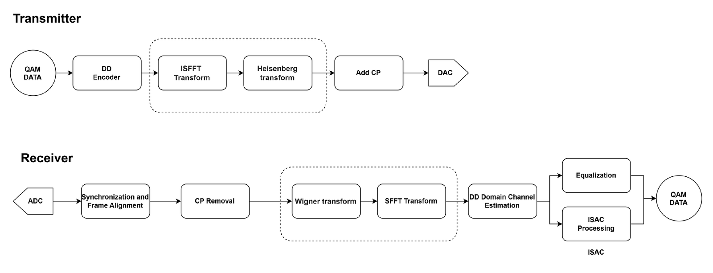
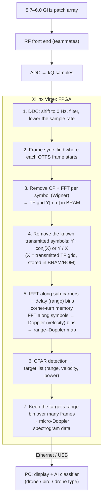

# Part 2 – Signal Processing Chain: OTFS-Based Drone Detection on FPGA

**Owner:** Dulina Ranaweera (220511N) · Group 20 FYP · [← back to project overview](../README.md)

This folder contains my work on the **digital signal processing (DSP)** of the 5.7–6.0 GHz drone-sensing head: an **OTFS-based radar processor** that will run on a **Xilinx Virtex FPGA**. It takes the I/Q samples coming from the patch array's RF front end and produces a **range–Doppler map**, a **target list** and **micro-Doppler data** for the AI drone classifier.

I use **ISFFT-based OTFS** (the "OFDM-style" OTFS: an OFDM modem with one extra 2-D transform), not Zak-OTFS, because it re-uses standard FFT blocks that map well onto an FPGA.

> **Status (October 2026):** Phase 0 – learning OFDM → OTFS → radar basics. The full work plan and parameter study are done (see [`docs/otfs-fpga-plan.md`](docs/otfs-fpga-plan.md)); the floating-point golden model is the next step.

---

## 1. Words used in this section

| Word | Meaning |
|---|---|
| **Sample (I/Q)** | One complex number from the ADC: an in-phase part I and a quadrature part Q. |
| **Delay → range** | Time for the echo to come back. Range = c × delay / 2. |
| **Doppler → velocity** | Small frequency shift caused by movement. Velocity v = λ × Doppler / 2 (λ = 5.13 cm at 5.85 GHz). |
| **Micro-Doppler** | Extra, fast-changing Doppler from spinning propellers – the "fingerprint" that separates drones from birds. |
| **OFDM** | Data sent on many narrow sub-carriers at once. Transmitter = IFFT, receiver = FFT. Used in Wi-Fi, 4G, 5G. |
| **Cyclic prefix (CP)** | A copy of the end of each OFDM symbol placed in front of it. It absorbs echoes; for radar it also sets the longest range that can be measured cleanly. |
| **Time–frequency (TF) grid** | A table with N rows (OFDM symbols = time slots) and M columns (sub-carriers = frequencies). |
| **Delay–Doppler (DD) grid** | A table of the same size whose rows are Doppler bins and columns are delay bins. OTFS places its symbols here. |
| **ISFFT / SFFT** | ISFFT turns the DD grid into the TF grid (one FFT along one direction, one IFFT along the other). SFFT is the reverse. |
| **Heisenberg / Wigner transform** | For ISFFT-OTFS these are simply the OFDM transmitter (IFFT + CP) and OFDM receiver (remove CP + FFT). |
| **Range–Doppler map** | A 2-D picture: a bright spot means "something at this distance moving at this speed". |
| **CFAR** | Constant False Alarm Rate detector – compares each cell of the map with the average noise of its neighbours to decide what is a real target. |
| **BRAM** | Small memory blocks inside the FPGA where the grids are stored while being processed. |
| **Corner turn** | Writing a grid row by row and reading it column by column – needed between the two FFT directions. |
| **Golden model** | A floating-point MATLAB / Python version of the whole chain. Every FPGA block is checked against it. |

## 2. Why OTFS for drone sensing?

OFDM works well for fixed or slow users, but a **fast-moving target spreads energy between sub-carriers** (inter-carrier interference, ICI), which corrupts both communication and sensing. OTFS places the symbols in the **delay–Doppler domain**, where each reflector (for example a drone) appears as **one compact spot** at its own delay and Doppler. That makes the channel look simple and steady, and it is exactly the information a radar needs: **range = delay, velocity = Doppler**.



*ISFFT-OTFS transmitter and receiver. The dashed boxes are the OTFS-specific parts; everything else is a normal OFDM modem. On the receiver side the "ISAC processing" branch is where the radar processing below happens. (Group 20 feasibility study, after Xiang et al. 2024 and the MathWorks OTFS example.)*

## 3. Planned processing chain and where the data lives



**Transmit side** (sensing transmitter): DD-domain symbols → ISFFT → IFFT + CP → DAC. Because a radar frame is known in advance, the first version can be computed in MATLAB, stored in FPGA memory and played out repeatedly.

## 4. Example system numbers (to be agreed with the team)

λ = 5.13 cm at 5.85 GHz, CP = 25 % of the symbol length.

| Bandwidth | M (sub-carriers) | N (symbols) | Range resolution | Max range set by CP | Frame length | Velocity resolution (one frame) |
|---|---|---|---|---|---|---|
| 100 MHz | 1024 | 64 | 1.5 m | 384 m | 0.82 ms | 31 m/s |
| 200 MHz | 1024 | 128 | 0.75 m | 192 m | 0.82 ms | 31 m/s |
| 300 MHz | 2048 | 128 | 0.5 m | 256 m | 1.09 ms | 23 m/s |

**Main finding:** one frame (≈ 1 ms) is **far too short to measure drone speed** – drones fly at 0–20 m/s. About **51 ms** of observation is needed for 0.5 m/s velocity resolution. So the processor must work on **many frames in a row** (a "dwell" of ≈ 50 frames or more), and the micro-Doppler spectrogram is built across frames. This sets the FPGA memory size and must be planned from the start.

## 5. Work plan

| Phase | Work | Duration | Status |
|---|---|---|---|
| 0 | Learn the basics: OFDM → ISFFT-OTFS → radar (range, Doppler, range–Doppler map, CFAR, micro-Doppler) | 2–3 weeks | 🔄 in progress |
| 1 | Fix the system numbers: bandwidth, M, N, CP, frames per dwell, target range – checked against the team's link budget | 1 week | ⏳ |
| 2 | Floating-point **golden model** (MATLAB / Python): OTFS TX → channel with a drone (body + spinning blades) + noise → RX chain → range–Doppler map → CFAR → spectrogram; save test vectors | 3–4 weeks | ⏳ |
| 3 | Fixed-point model: bit widths at each stage, FFT scaling, error vs. golden model | 2 weeks | ⏳ |
| 4 | FPGA blocks in Vivado, one at a time with testbenches: FFT IP → CP removal → symbol removal → corner turn → 2nd FFT → CFAR → output; AXI-Stream between blocks; report LUT / DSP / BRAM / clock | 6–8 weeks | ⏳ |
| 5 | Hardware tests: digital loopback → DAC–cable–ADC with known delays → over the air with a corner reflector and a fan (micro-Doppler) → real drone | 4+ weeks | ⏳ |
| 6 | Integration with the RF board, streaming to the AI classifier, paper | – | ⏳ |

**Mid-review target:** Phases 0–3 finished and at least the FFT + range–Doppler part running in FPGA simulation.

Full plan, open questions and paper list: [`docs/otfs-fpga-plan.md`](docs/otfs-fpga-plan.md). Lesson-by-lesson learning plan: [`docs/otfs-learning-plan.md`](docs/otfs-learning-plan.md).

## 6. Code so far

[`python/ofdm-basics/`](python/ofdm-basics/) – first exercises (Part A of the learning plan). Run with Python 3 + NumPy:

| File | What it shows |
|---|---|
| [`lesson1_ofdm_ifft_fft.py`](python/ofdm-basics/lesson1_ofdm_ifft_fft.py) | The OFDM transmitter is an IFFT and the receiver is an FFT: 4 QPSK symbols → time signal → back to the same symbols. |
| [`lesson2_cyclic_prefix_multipath.py`](python/ofdm-basics/lesson2_cyclic_prefix_multipath.py) | Adds a cyclic prefix, passes the signal through a 2-path channel (direct path + echo 1 sample late, gain 0.5), and recovers the symbols with a one-tap equalizer per sub-carrier. |

```bash
pip install numpy
python python/ofdm-basics/lesson1_ofdm_ifft_fft.py
python python/ofdm-basics/lesson2_cyclic_prefix_multipath.py
```

## 7. Open questions (to settle with the team and supervisors)

1. Who transmits the OTFS signal – our own transmitter next to the receiver (monostatic), a separate transmitter (bistatic), or an existing signal?
2. Exact Virtex board, ADC and DAC: sample rate, bits, interface (JESD204B/C, LVDS, FMC card)?
3. Bandwidth inside 5.7–6.0 GHz, and the expected drone distance?
4. Sensing only, or also decode communication data on the FPGA?
5. Work split with teammates (their OFDM / OTFS simulations can be re-used for Phase 2).

## 8. Contribution

No published work was found that combines all three of **ISFFT-OTFS + drone detection + real-time FPGA processing**. Closing that gap is the aim of this part of the project.

See [`references.md`](references.md) for the papers and reference code.
